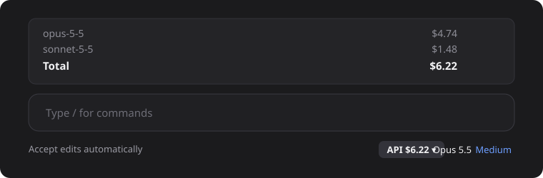

<div align="center">

# API

**See what your Claude Code session would cost at API prices.**<br>
A tiny button in Claude Desktop. One click, per-model breakdown.

[](LICENSE)


[Deutsch](README.de.md)



</div>

## What it does

- Shows **`API $x.xx · 4.8M`** (cost and tokens of the current session) bottom right, next to the model name, in every local chat.
- One click expands a list above the input: **cost and tokens per model, the total, and a rough estimate of what it costs Anthropic to serve it**.
- Updates after every reply. Reads your local usage logs through [ccusage](https://github.com/ryoppippi/ccusage); nothing leaves your machine.

> The numbers are **list prices** of the Anthropic API, not your actual bill. This is useful if you use a plan or a proxy and want to know the value of what you consume. The "Anthropic" line is a rough guess (40 % of list price, based on reported gross margins), not an official figure.

## Install

**1. Install ccusage** (once):

```
npm install -g ccusage
```

**2. Add the marketplace and the plugin** (two commands, any terminal):

```
claude plugin marketplace add Henner4746/claude-code-api-cost
claude plugin install api@henrik-mods --scope user
```

**3. Restart Claude Desktop.** The button appears in every local chat.

Prefer clicking? In Claude Desktop: **+ next to the prompt → Plugins → Add marketplace**, enter `Henner4746/claude-code-api-cost`, then **Add plugin → api**. You can switch it on and off there at any time.

## Notes

| | |
|---|---|
| Requirements | Windows, Claude Desktop with the Code tab, Node.js (for ccusage) |
| Cloud chats | Not supported. They do not load local plugins. |
| List position | The expanded list sits above the input and is hidden while a question dialog is shown. |
| Terminal `claude plugin list` | An older CLI may report "failed to load". The plugin uses the newer hooks format that the desktop app understands. |

## Uninstall

```
claude plugin uninstall api@henrik-mods
```

## License

[MIT](LICENSE)
